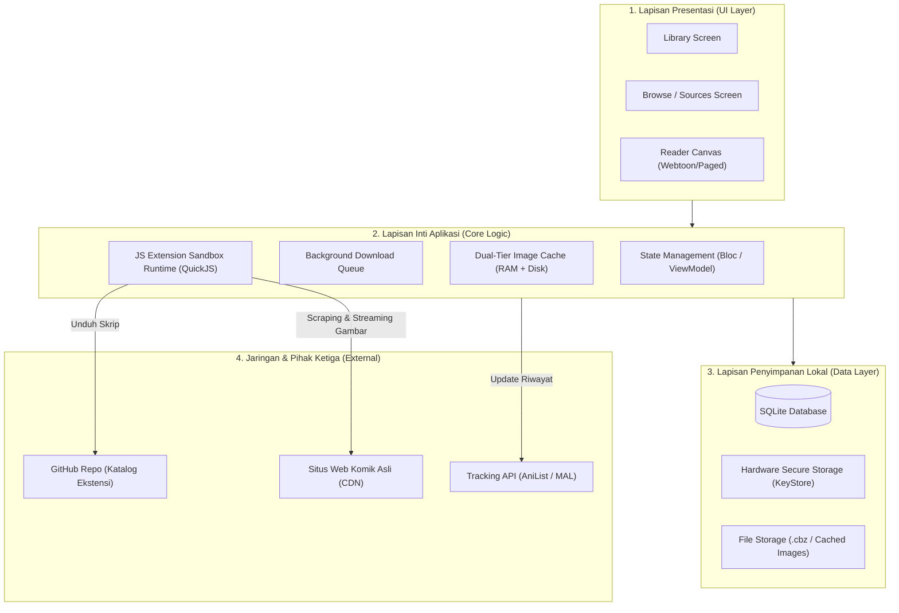
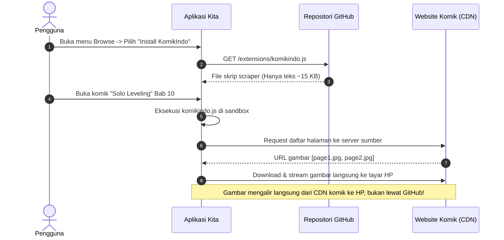
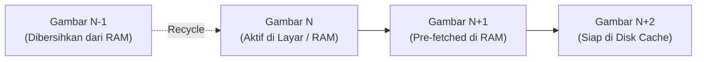

# 01. Arsitektur Sistem & Alur Runtime

Dokumen ini menjelaskan rancangan arsitektur tingkat tinggi (*High-Level Architecture*), cara kerja modul ekstensi, dan bagaimana komponen sistem saling berinteraksi.

---

## 1. Konsep Arsitektur Terdesentralisasi (Decoupled Architecture)

Aplikasi dibangun dengan prinsip pemisahan total antara **Core Reader Engine** dan **Content Providers (Extensions)**:

---

## 2. Peran GitHub Repository vs Website Sumber Komik

Ada perbedaan sangat penting antara peran **GitHub** dan peran **Website Komik**:

### Mengapa Pola Ini Wajib Digunakan?
1. **Bebas Masalah Hak Cipta (DMCA Compliant):** Repositori GitHub Anda bersih dari konten berhak cipta (hanya kode open-source).
2. **Nol Biaya Server:** Gambar komik ditanggung langsung oleh server penyedia sumber.
3. **Pembaruan Instan:** Jika website komik mengganti layout atau domain, Anda hanya perlu mengedit file script `.js` di GitHub tanpa harus merilis ulang aplikasi di Play Store.

---

## 3. High-Performance Reader Pipeline (Anti-Lag & Anti-OOM)

Bab komik format Webtoon bisa memiliki 50+ potongan gambar berukuran panjang. Untuk mencegah HP kehabisan RAM (*Out of Memory*):

1. **Virtual List Windowing:** Hanya 2-3 elemen gambar yang dialokasikan dalam RAM secara aktif pada satu waktu.
2. **Auto Pre-Fetching:** Sistem secara cerdas mengunduh 2 gambar di depan posisi scroll pengguna secara senyap di background.
3. **Decoded Bitmap Downsampling:** Gambar di-downsample sesuai resolusi layar perangkat sebelum dirender, menghemat pemakaian memori hingga 70%.

---

## 4. Penanganan Cloudflare & Bot Protection

Banyak situs komik menggunakan proteksi Cloudflare Turnstile / Bot Fight.
1. Saat aplikasi menerima respon status `HTTP 403 Forbidden` atau mendeteksi halaman Cloudflare:
2. Aplikasi mengaktifkan **In-App Headless Webview** (jendela browser internal).
3. Webview menyelesaikan tantangan Cloudflare secara otomatis atau dengan interaksi sekali ketuk pengguna.
4. Cookie `cf_clearance` dan nilai `User-Agent` diambil dan disimpan ke dalam session cache.
5. Permintaan data berikutnya menggunakan cookie tersebut sehingga akses langsung lancar.
