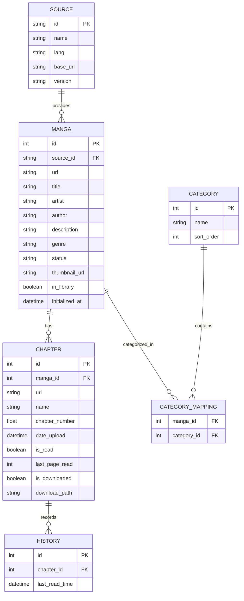

# 03. Desain Basis Data & Skema SQLite

Dokumen ini mendefinisikan rancangan basis data relasional lokal menggunakan **SQLite** yang dioptimalkan untuk performa query cepat pada ribuan data komik.

---

## 1. Diagram Hubungan Entitas (Entity-Relationship Diagram / ERD)



---

## 2. Skrip DDL SQLite (Skema Tabel & Indeks)

```sql
-- 1. Tabel Sumber Ekstensi
CREATE TABLE IF NOT EXISTS sources (
    id TEXT PRIMARY KEY,
    name TEXT NOT NULL,
    lang TEXT NOT NULL DEFAULT 'id',
    base_url TEXT NOT NULL,
    version TEXT NOT NULL
);

-- 2. Tabel Komik (Manga)
CREATE TABLE IF NOT EXISTS manga (
    id INTEGER PRIMARY KEY AUTOINCREMENT,
    source_id TEXT NOT NULL,
    url TEXT NOT NULL,
    title TEXT NOT NULL,
    artist TEXT,
    author TEXT,
    description TEXT,
    genre TEXT,
    status TEXT, -- 'ONGOING', 'COMPLETED', 'UNKNOWN'
    thumbnail_url TEXT,
    in_library INTEGER NOT NULL DEFAULT 0,
    initialized_at DATETIME DEFAULT CURRENT_TIMESTAMP,
    FOREIGN KEY (source_id) REFERENCES sources (id) ON DELETE CASCADE,
    UNIQUE (source_id, url)
);

-- 3. Tabel Bab Komik (Chapters)
CREATE TABLE IF NOT EXISTS chapters (
    id INTEGER PRIMARY KEY AUTOINCREMENT,
    manga_id INTEGER NOT NULL,
    url TEXT NOT NULL,
    name TEXT NOT NULL,
    chapter_number REAL NOT NULL,
    date_upload DATETIME,
    is_read INTEGER NOT NULL DEFAULT 0,
    last_page_read INTEGER NOT NULL DEFAULT 0,
    is_downloaded INTEGER NOT NULL DEFAULT 0,
    download_path TEXT,
    FOREIGN KEY (manga_id) REFERENCES manga (id) ON DELETE CASCADE,
    UNIQUE (manga_id, url)
);

-- 4. Tabel Kategori
CREATE TABLE IF NOT EXISTS categories (
    id INTEGER PRIMARY KEY AUTOINCREMENT,
    name TEXT NOT NULL UNIQUE,
    sort_order INTEGER NOT NULL DEFAULT 0
);

-- 5. Tabel Relasi Kategori & Komik (Many-to-Many)
CREATE TABLE IF NOT EXISTS category_mappings (
    manga_id INTEGER NOT NULL,
    category_id INTEGER NOT NULL,
    PRIMARY KEY (manga_id, category_id),
    FOREIGN KEY (manga_id) REFERENCES manga (id) ON DELETE CASCADE,
    FOREIGN KEY (category_id) REFERENCES categories (id) ON DELETE CASCADE
);

-- 6. Tabel Riwayat Baca (Reading History)
CREATE TABLE IF NOT EXISTS history (
    id INTEGER PRIMARY KEY AUTOINCREMENT,
    chapter_id INTEGER NOT NULL UNIQUE,
    last_read_time DATETIME NOT NULL DEFAULT CURRENT_TIMESTAMP,
    FOREIGN KEY (chapter_id) REFERENCES chapters (id) ON DELETE CASCADE
);
```

---

## 3. Strategi Indexing untuk Performa Tinggi

Agar pembacaan data di perpustakaan (*Library*) tidak tersendat ketika komik bertambah hingga ribuan judul:

```sql
-- Indeks pencarian komik di perpustakaan
CREATE INDEX IF NOT EXISTS idx_manga_library ON manga (in_library, title);

-- Indeks pengurutan bab komik
CREATE INDEX IF NOT EXISTS idx_chapters_manga_number ON chapters (manga_id, chapter_number DESC);

-- Indeks filter bab yang belum dibaca
CREATE INDEX IF NOT EXISTS idx_chapters_unread ON chapters (manga_id, is_read);

-- Indeks pengurutan riwayat baca terakhir
CREATE INDEX IF NOT EXISTS idx_history_time ON history (last_read_time DESC);
```

---

## 4. Contoh Query Esensial

### Mengambil Seluruh Komik di Perpustakaan Beserta Jumlah Bab Belum Dibaca
```sql
SELECT 
    m.id,
    m.title,
    m.thumbnail_url,
    COUNT(c.id) AS total_chapters,
    SUM(CASE WHEN c.is_read = 0 THEN 1 ELSE 0 END) AS unread_chapters
FROM manga m
LEFT JOIN chapters c ON m.id = c.manga_id
WHERE m.in_library = 1
GROUP BY m.id
ORDER BY m.title ASC;
```

### Mengambil Riwayat Baca Terakhir
```sql
SELECT 
    m.title AS manga_title,
    m.thumbnail_url,
    c.name AS chapter_name,
    c.chapter_number,
    c.last_page_read,
    h.last_read_time
FROM history h
JOIN chapters c ON h.chapter_id = c.id
JOIN manga m ON c.manga_id = m.id
ORDER BY h.last_read_time DESC
LIMIT 50;
```
