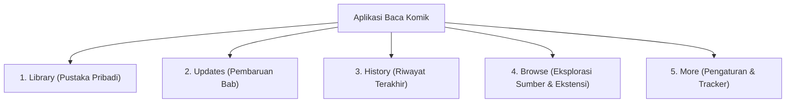

# 04. Desain Antarmuka Pengguna & Pengalaman Pengguna (UI/UX)

Dokumen ini merinci struktur navigasi utama, tata letak layar (*screen layouts*), dan interaksi gestur pembaca komik.

---

## 1. Struktur Navigasi Utama (Bottom Navigation Bar)

Aplikasi menggunakan pola navigasi bawah 5 tab standar industri:



---

## 2. Rincian Tata Letak Tiap Layar (Screen Layouts)

### A. Layar Pustaka (Library Screen)
* **Header:** Bilah pencarian instan, filter kategori (chips: *All*, *Reading*, *Completed*), dan tombol opsi urutan (*Alphabetical*, *Last Read*, *Total Chapters*).
* **Grid Area:** Tampilan kartu komik 3 kolom (portrait) dengan rasio cover `2:3`.
* **Badge:** Lingkaran kecil di sudut kanan atas cover yang menunjukkan jumlah bab belum dibaca.
* **Pull-to-refresh:** Tarik ke bawah untuk memicu pengecekan bab baru.

### B. Layar Detail Komik (Manga Detail Screen)
* **Backdrop & Header:** Gambar cover dengan efek blur di latar belakang, judul komik, status (Ongoing/Completed), penulis, dan rating.
* **Action Buttons:**
  - Tombol **"Add to Library"** / **"In Library"**.
  - Tombol **"Start Reading"** / **"Resume Chapter X"**.
  - Tombol **"Webview"** untuk membuka langsung di browser internal.
* **Tab Chapters:** Daftar bab berurutan dari nomor terbesar ke terkecil, status baca, tanggal upload, dan tombol download per bab.

---

### C. Layar Reader (Canvas Penampil Gambar)

```
+-------------------------------------------------------+
|  [< Back]     Solo Leveling - Chapter 120    [Settings]| <- Overlay Atas
+-------------------------------------------------------+
|                                                       |
|                     [ GAMBAR 1 ]                      |
|                                                       |
|                     [ GAMBAR 2 ]                      |
|                                                       |
|                     [ GAMBAR 3 ]                      |
|                                                       |
+-------------------------------------------------------+
|  [Prev Ch]  |<------- O Slider Halaman ------->| [Next]| <- Overlay Bawah
+-------------------------------------------------------+
```

* **Overlay Menu:** Muncul saat layar bagian tengah disentuh satu kali (*single tap*). Berisi slider halaman, tombol lompat bab, dan konfigurasi mode baca.
* **Mode Webtoon:** Gambar disusun vertikal tanpa batas putih (*seamless*).
* **Mode Paged:** Membalik halaman dengan gesekan horizontal (*swipe*) atau ketukan di sisi tepi layar.
* **Interaksi Gestur Layar Reader:**

```
+------------------+------------------+------------------+
|                  |                  |                  |
|    KIRI (30%)    |   TENGAH (40%)   |    KANAN (30%)   |
|                  |                  |                  |
|  Ketuk:          |  Ketuk:          |  Ketuk:          |
|  Halaman         |  Buka/Tutup      |  Halaman         |
|  Sebelumnya      |  Menu Overlay    |  Selanjutnya     |
|                  |                  |                  |
+------------------+------------------+------------------+
```

---

### D. Layar Eksplorasi Sumber (Browse & Extensions)
* **Sub-Tab Sources:** Daftar website sumber yang sudah terpasang (misal: KomikIndo, MangaDex, AsuraScans).
* **Sub-Tab Extensions:** Daftar katalog ekstensi dari repositori GitHub dengan tombol **"Install"**, **"Update"**, atau **"Uninstall"**.
* **Global Search Bar:** Kolom pencarian yang bisa mencari satu judul ke semua sumber sekaligus secara simultan.

---

## 3. Tema & Skema Warna (Theming)

* **OLED Dark Mode (Default):** Menggunakan warna hitam pekat (`#000000`) untuk latar belakang agar sangat hemat baterai di layar AMOLED ponsel dan nyaman di mata saat membaca malam hari.
* **Accent Color:** Biru keunguan / Cyan modern (`#2196F3` / `#00E5FF`) untuk tombol dan indikator aktif.
* **Fitur Tambahan:** Filter invert color untuk komik hitam-putih agar latar putih gambar menjadi hitam pekat.
