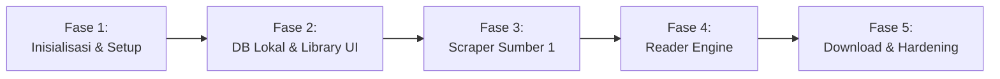

# 05. Roadmap & Tahapan Pengembangan Aplikasi

Dokumen ini merinci urutan langkah pengerjaan aplikasi dari fase persiapan lingkungan kerja (*environment setup*) hingga rilis APK siap pasang di perangkat Android.

---

## 1. Status Kesiapan Lingkungan Kerja di Laptop Windows

Pemeriksaan sistem lokal memastikan komponen dasar sudah tersedia:
* ✅ **Android Studio & SDK:** Siap di `C:\Program Files\Android\Android Studio`
* ✅ **Java / OpenJDK 21:** Siap di bundle Android Studio
* ✅ **VS Code:** Siap sebagai editor kode utama
* ✅ **Git:** Siap untuk version control

---

## 2. Tahapan Pengerjaan Bertahap (Sprint Milestones)



---

### Fase 1: Inisialisasi Proyek & Skeleton (Minggu 1)
- [ ] Buat struktur proyek di folder `E:\aplikasibacakomik\src`.
- [ ] Konfigurasi arsitektur state management (Bloc / Riverpod) dan dependency injection.
- [ ] Setup navigasi 5 tab bawah (*Bottom Navigation Bar*).
- [ ] Implementasi tema OLED Dark Mode.

### Fase 2: Database Lokal & Layar Perpustakaan (Minggu 2)
- [ ] Implementasi skema SQLite (Tabel `manga`, `chapters`, `categories`, `history`).
- [ ] Buat DAO (*Data Access Object*) untuk query performa tinggi.
- [ ] Bangun tampilan Grid Library dengan filter kategori dan unread badge.
- [ ] Buat logika penambahan komik ke Pustaka dan penghapusan komik.

### Fase 3: Engine Ekstensi & Integrasi Sumber Pertama (Minggu 3)
- [ ] Integrasikan engine JavaScript sandbox (QuickJS).
- [ ] Buat kontrak interface standar: `getPopularManga()`, `searchManga()`, `getMangaDetails()`, `getPageList()`.
- [ ] Bangun 1 ekstensi uji coba pertama (contoh: sumber berbasis API seperti MangaDex atau sumber scraper lokal seperti KomikIndo).
- [ ] Bangun layar Browse untuk menampilkan komik dari sumber tersebut.

### Fase 4: Reader Engine Canvas (Minggu 4)
- [ ] Buat widget penampil gambar vertikal (Mode Webtoon).
- [ ] Implementasi *Virtual Windowing* dan *Pre-fetching* (hanya memuat 2-3 gambar ke RAM).
- [ ] Implementasi gestur sentuh (Tap zona kiri/tengah/kanan dan Pinch-to-Zoom).
- [ ] Hubungkan riwayat baca: simpan posisi halaman terakhir secara real-time ke database.

### Fase 5: Download Manager & Keamanan (Minggu 5)
- [ ] Implementasi *Background Downloader Queue* untuk mengunduh gambar bab secara paralel.
- [ ] Format penyimpanan lokal (.cbz atau folder gambar).
- [ ] Implementasi deteksi offline: buka bab dari disk jika sudah terunduh.
- [ ] Implementasi penguncian biometrik (Fingerprint/PIN).
- [ ] Aktifkan *Code Obfuscation* (R8/ProGuard) saat proses build release APK.

---

## 3. Perintah Uji Coba & Build APK di Windows

Setelah kode ditulis di folder `src/`:

```powershell
# 1. Menjalankan aplikasi dalam mode debug di emulator / HP Android:
flutter run

# 2. Membuat file instalasi APK Release siap pasang di HP:
flutter build apk --release --obfuscate --split-debug-info=build/app/outputs/symbols

# 3. Hasil file APK siap instal akan berada di:
# build/app/outputs/flutter-apk/app-release.apk
```
