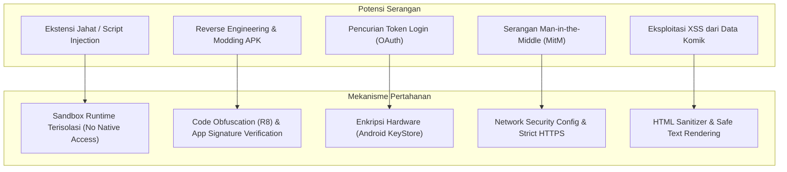

# 06. Arsitektur Keamanan Aplikasi (Application Security & Anti-Hack)

Dokumen ini mendefinisikan langkah pertahanan teknis untuk memastikan aplikasi aman dari serangan siber, penyusupan ekstensi berbahaya (*malicious scrapers*), kebocoran token akun, dan pembajakan kode (*reverse engineering*).

---

## 1. Model Vektor Ancaman (Threat Modeling)

---

## 2. Rincian Proteksi Teknis

### A. Sandbox Ekstensi JavaScript (Isolasi Mutlak)
Skrip ekstensi dari luar berpotensi disusupi kode jahat jika dibuat oleh kontributor anonim. Untuk itu:
1. **No Filesystem Access:** Ekstensi tidak diizinkan membaca atau menulis file apapun di memori HP selain dari direktori cache aplikasi miliknya sendiri.
2. **No Native Hardware Access:** Ekstensi tidak memiliki binding ke kamera, mikrofon, lokasi GPS, atau kontak.
3. **No Arbitrary Code Execution:** Perintah berbahaya seperti `eval()` atau `Function()` dinonaktifkan di runtime JS.
4. **Controlled HTTP Client:** Seluruh komunikasi jaringan wajib melewati HTTP Client aplikasi yang sudah dipasangi filter batasan domain (*whitelisted domains*).

---

### B. Anti-Reverse Engineering & Modding Protection
Aplikasi sering dibongkar oleh pihak ketiga untuk disisipi iklan (*adware*) atau malware:
1. **Code Obfuscation (R8 / ProGuard):** Seluruh nama kelas, variabel, dan metode diacak menjadi satu atau dua huruf tanpa makna (contoh: `MangaDownloader.start()` menjadi `a.b()`).
2. **Signature Verification:** Saat aplikasi diluncurkan, sistem memeriksa hash kunci SHA-256 penandatangan APK (*Signing Certificate*). Jika APK telah di-repack atau dimodifikasi oleh peretas, aplikasi akan menolak berjalan dan menutup otomatis.
3. **Root / Emulator Detection (Opsional):** Mendeteksi apakah perangkat dalam kondisi *rooted* untuk mencegah injeksi memori aktif via Frida atau Xposed Framework.

---

### C. Keamanan Penyimpanan Kredensial (Token Encryption)
Token login untuk akun pihak ketiga (AniList, MyAnimeList) wajib disimpan secara aman:
* Menggunakan **Android Keystore System** dan **EncryptedSharedPreferences** dengan algoritma enkripsi **AES-256-GCM**.
* Kunci enkripsi tersimpan di hardware chip keamanan prosesor HP (*Secure Element*), sehingga tidak bisa dibaca meskipun perangkat disambungkan ke komputer melalui USB debugging.

---

### D. Sanitasi Data Web (Anti-XSS & Anti-Exploit)
Data judul, sinopsis, dan nama bab yang diambil dari internet berpotensi mengandung tag HTML jahat:
* Seluruh data teks yang diparsing wajib melewati fungsi *HTML Entity Escaping*.
* Larangan rendering string mentah ke dalam Webview. Teks selalu dirender sebagai widget teks native (misal: widget `Text` pada Flutter) yang secara alami kebal terhadap eksekusi script HTML/JavaScript.
