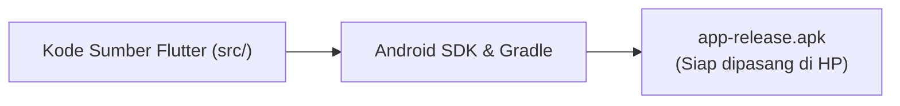
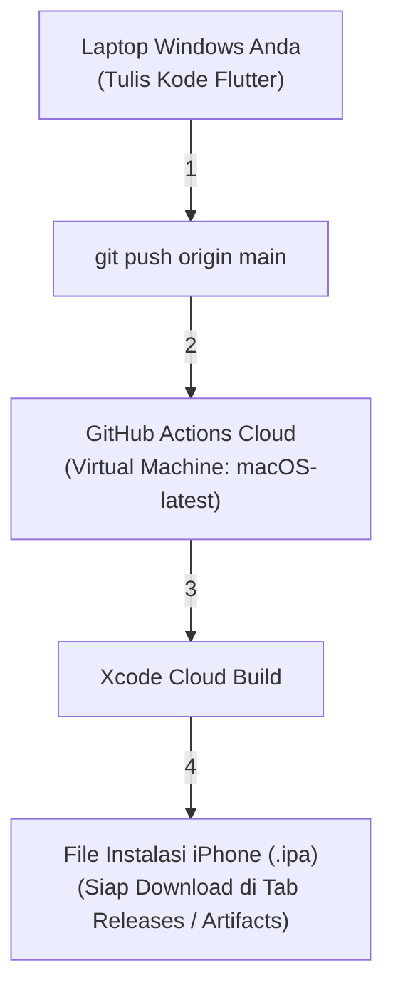

# 07. Panduan Build Aplikasi (Android APK & Build iOS Gratis via Cloud)

Dokumen ini menjelaskan alur kompilasi aplikasi untuk menghasilkan file instalasi **Android (.apk)** langsung di laptop Windows Anda, serta strategi menghasilkan file instalasi **iOS (.ipa)** secara gratis tanpa perlu memiliki komputer Mac menggunakan **GitHub Actions CI/CD**.

---

## 1. Alur Build Android APK di Laptop Windows

Kompilasi Android dilakukan langsung secara lokal di laptop Windows Anda:



### Langkah Kompilasi Android:
1. Buka terminal di folder proyek (`E:\aplikasibacakomik\src`).
2. Jalankan perintah:
   ```powershell
   flutter build apk --release
   ```
3. File instalasi APK yang dihasilkan akan berada di:
   `build/app/outputs/flutter-apk/app-release.apk`
4. Pindahkan file tersebut ke HP Android Anda dan instal secara langsung.

---

## 2. Cara Build untuk iOS Tanpa Perlu Komputer Mac (GitHub Actions)

Meskipun laptop Anda bersistem operasi Windows, Anda tetap dapat menghasilkan file aplikasi iOS menggunakan fasilitas komputer Mac gratis yang disediakan oleh **GitHub Actions**:



---

## 3. Template Skrip Otomatisasi GitHub Actions (`.github/workflows/build_ios.yml`)

Skrip berikut dapat dipasang di repositori GitHub Anda:

```yaml
name: Build iOS IPA (Free Cloud Runner)

on:
  workflow_dispatch: # Bisa dijalankan manual dengan 1 klik tombol di GitHub
  push:
    tags:
      - 'v*' # Otomatis jalan saat Anda membuat tag rilis baru

jobs:
  build-ios:
    name: Build iOS Application on macOS Runner
    runs-on: macos-14 # Menggunakan Mac cloud gratis dari GitHub
    
    steps:
      - name: Checkout Repository
        uses: actions/checkout@v4

      - name: Setup Java
        uses: actions/setup-java@v3
        with:
          distribution: 'zulu'
          java-version: '17'

      - name: Setup Flutter SDK
        uses: subosito/flutter-action@v2
        with:
          channel: 'stable'
          cache: true

      - name: Install Dependencies
        run: flutter pub get
        working-directory: ./src

      - name: Build iOS Application
        run: flutter build ios --release --no-codesign
        working-directory: ./src

      - name: Package Payload to .IPA
        run: |
          cd src/build/ios/iphoneos
          mkdir Payload
          cp -r Runner.app Payload
          zip -r app-unsigned.ipa Payload
        
      - name: Upload iOS Artifact
        uses: actions/upload-artifact@v4
        with:
          name: iOS-Package-IPA
          path: src/build/ios/iphoneos/app-unsigned.ipa
```

### Keuntungan Cara Ini:
1. **100% Gratis:** GitHub menyediakan kuota kompilasi bulanan gratis untuk akun publik/pribadi.
2. **Tidak Perlu Beli MacBook:** Anda tetap bekerja dengan nyaman di laptop Windows Anda.
3. **Hasil Resmi:** File `.ipa` siap diunduh langsung dari tab **Actions / Artifacts** di GitHub dan dapat dipasang ke iPhone menggunakan alat seperti Sideloadly, AltStore, atau TrollStore.
