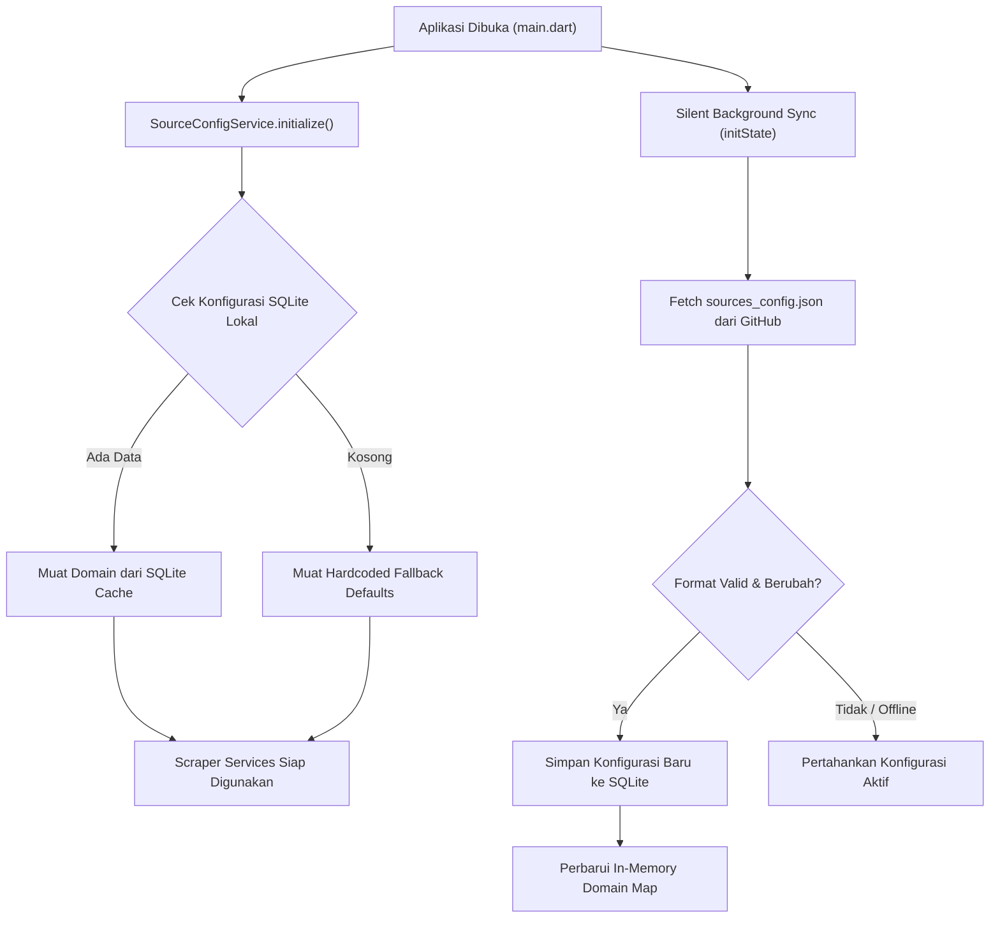

# ARSITEKTUR SISTEM KSHCANS

Dokumen ini mendokumentasikan arsitektur modul dan interaksi antarkomponen aplikasi KsHcans.

---

## 1. STRUKTUR LAPISAN APLIKASI (APPLICATION LAYERS)

1. Presentation Layer (`lib/features/`):
   - Browse: Katalog sumber komik dan pencarian global lintas 9 sumber.
   - Reader: Mesin pembaca lembaran gambar komik (Infinity Continuous Scroll & Single Page).
   - Library: Pustaka komik tersimpan secara offline dan pemantauan unread chapters.
   - Updates: Feed komik terbaru yang diperbarui secara real-time.
   - History: Riwayat bacaan terurut waktu dengan dukungan mode incognito.
   - Settings: Pengaturan tema, keamanan PIN, dan pengecekan pembaruan sistem.
2. Provider & State Layer (`lib/providers/`):
   - `MangaProvider`: Manajemen status pustaka, pencarian, dan pemuatan bab.
   - `ThemeProvider`: Manajemen tema aplikasi (OLED Dark Mode).
3. Core Service Layer (`lib/core/services/`):
   - Scraper Services: `ShinigamiService`, `KomikIndoService`, `BacaKomikService`, `KomikuService`, `KiryuuService`, `DoujinDesuService`, `MangaDexService`, `IkiruService`, `LuvyaaService`.
   - Domain & Configuration: `SourceConfigService` (Remote Dynamic Domain Resolver via GitHub & SQLite).
   - Security Services: `SecurityService`, `SecureScreenService`.
   - Update & Notification Services: `AppUpdateService`, `ChapterUpdateService`, `NotificationService`.
   - Storage & Database: `DBHelper` (SQLite lokal), `DownloadService`.
4. Native Android Layer (`android/app/src/main/`):
   - `MainActivity.kt`: MethodChannel `kshcans/secure_screen` dan `kshcans/installer`.
   - `FileProvider`: Menyediakan URI aman untuk paket instalasi APK pembaruan.

---

## 2. DIAGRAM ALUR PEMBARUAN IN-APP (OTA)

```
[Flutter UI: Settings / Startup]
             |
             v
    [AppUpdateService]
             |
   (Cek version.json / GitHub)
             |
             +---> Versi Baru Ditemukan?
                       |
                  (Ya) v
            [Dialog Modal OTA]
                       |
               (Klik 'Perbarui')
                       |
                       v
         [Download Stream APK] (path_provider cache)
                       |
                       v
    [MethodChannel 'kshcans/installer']
                       |
                       v
    [Native Android FileProvider & Intent.ACTION_VIEW]
                       |
                       v
         [Package Installer Sistem]
```


---

## 3. DIAGRAM ALUR DYNAMIC REMOTE DOMAIN RESOLVER


